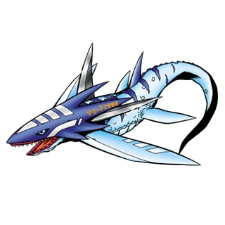

# tylomon

<div align="center">
  



[](https://brpaz.github.io/tylomon)


</div>

> Monitor HTTP traffic between Docker containers in real time, directly from the terminal.

> [!WARNING]
> **AI disclosure.** tylomon is vibe coded: the code, tests and documentation were written by AI coding assistants under human direction. The first version was written with Claude Opus 4.6; later work, including most features, was done with Claude Sonnet 5.5 in Claude Code. It was built to experiment with AI workflows and to solve a specific itch. There are automated tests and an end-to-end check against a sample Docker stack, but no independent code review or security audit. tylomon captures network traffic and needs elevated capabilities (`CAP_NET_RAW`, `CAP_NET_ADMIN`), so read the code before running it on a machine or network you care about. Use it at your own risk.

## About

tylomon captures packets on Docker bridge network interfaces, reassembles TCP streams, parses HTTP request/response pairs, and displays them in an interactive terminal dashboard.

## Features

- Real-time HTTP traffic capture on Docker bridge networks
- Automatic Docker Compose project and network discovery; captures follow networks that are recreated or added while running
- Container name resolution (shows container names instead of IPs)
- Full HTTP header and body inspection
- Detail pane with a pinned summary, syntax-coloured JSON bodies and hex dumps for binary data
- Chunked transfer-encoding decoding and gzip / deflate / brotli body decoding
- Keep-alive connection support
- Structured filters (`status:5xx`, `dst:api`, `>500ms`, negation) and sort by response time
- Record traffic to pcap (`--write`) and replay it later without root or Docker (`--read`)
- JSON Lines streaming (`--no-tui`) and HAR export (`--har`, or `e` in the TUI)
- Service map (`m`): requests, errors and p50/p95 latency per source→destination
- Keyboard and mouse driven TUI: click or double-click to select and open, wheel to scroll, drag to select and copy text in the detail pane

## Getting Started

### Requirements

- Linux (uses bridge interface capture via libpcap)
- Docker daemon running
- `libpcap` installed
- Root or `CAP_NET_RAW` + `CAP_NET_ADMIN` capabilities. Prefer granting the capabilities over `sudo`, which can hide your Wayland/X11 session (clipboard) and Compose environment:

  ```bash
  sudo setcap cap_net_raw,cap_net_admin=eip /usr/local/bin/tylomon
  ```

  Re-run `setcap` after every rebuild. When developing, `task run` does it for you.

### Installation

#### From source

```bash
# Install system dependency
sudo apt-get install libpcap-dev   # Debian/Ubuntu
sudo dnf install libpcap-devel     # Fedora/RHEL

# Build
cargo build --release

# Install
sudo cp target/release/tylomon /usr/local/bin/
```

#### Docker

```bash
docker pull ghcr.io/brpaz/tylomon:latest
```

## Usage

### Pick a target interactively

```bash
cd my-project && sudo tylomon
```

Without `--project` or `--network`, tylomon lists the Compose project found in the current directory (`compose.yaml`, `compose.yml`, `docker-compose.yaml` or `docker-compose.yml`, or the files in `COMPOSE_FILE`) plus every Docker bridge network that has containers. Use `j`/`k` and `Enter` to select, `/` to filter. The last choice is preselected next time. Selecting a Compose project captures on all of its networks.

A sample project to try it out lives in [`examples/`](examples/):

```bash
cd examples && docker compose up -d && sudo tylomon
```

### Monitor a Docker Compose project

```bash
sudo tylomon --project my-compose-project
```

### Monitor a specific Docker network

```bash
sudo tylomon --network my-network-name
```

### Record and replay

```bash
sudo tylomon --project my-compose-project --write session.pcap
tylomon --read session.pcap          # no root or Docker needed
```

### Scripting and export

```bash
tylomon --no-tui --project my-compose-project | jq 'select(.status >= 500)'
tylomon --project my-compose-project --har session.har
```

### Run via Docker

```bash
docker run --rm -it \
  --cap-add=NET_RAW --cap-add=NET_ADMIN \
  --network host \
  ghcr.io/brpaz/tylomon:latest \
  --project my-compose-project
```

### Options

```
Usage: tylomon [OPTIONS]

Options:
  -p, --project <PROJECT>              Docker compose project name to monitor
  -n, --network <NETWORK>              Docker network name to capture on
  -w, --write <FILE>                   Record captured packets to a pcap file
  -r, --read <FILE>                    Replay a pcap file instead of capturing live
      --no-tui                         Write exchanges to stdout as JSON Lines instead of showing the TUI
      --har <FILE>                     Save all captured exchanges to a HAR file on exit
      --log-file <LOG_FILE>            Log file path [default: tylomon.log]
      --max-exchanges <MAX_EXCHANGES>  Maximum exchanges to keep in memory [default: 1000]
  -h, --help                           Print help
  -V, --version                        Print version
```

## Keyboard and mouse

Press `?` in the app for the full list. The essentials:

| Key | Action |
|-----|--------|
| `j` / `k` | Select next / previous exchange (scrolls the detail pane when it has focus) |
| `Tab` | Switch focus between list and detail |
| `/` | Filter (`status:5xx dst:api >500ms -path:/health`) |
| `s` | Sort by capture order / slowest first |
| `m` | Service map |
| `z` | Zoom the focused pane full screen |
| `f` | Follow the newest exchange |
| `p` | Pause / resume |
| `y` / `1` / `2` / `3` | Copy exchange / request / response / `curl` command |
| `e` | Export the listed exchanges to a HAR file |
| `?` | Help |
| `q` / `Esc` | Clear selection, zoom or filter, then quit |

With the mouse: click to select, double-click to open, wheel to scroll, drag in the detail pane to select and copy text, drag the border between the panes to resize them.

See the [keybindings reference](https://brpaz.github.io/tylomon/reference/keybindings/) for everything.

## Development

### Prerequisites

The project uses [devenv.sh](https://devenv.sh/) to manage the development environment. With devenv installed:

```bash
devenv shell
```

This provides Rust toolchain, libpcap, [Task](https://taskfile.dev/), [Lefthook](https://github.com/evilmartians/lefthook), cargo-watch, and cargo-nextest.

### Common tasks

```bash
task fmt          # Format code
task lint         # Run fmt check + clippy
task test         # Run tests
task build        # Build debug binary
task build:release # Build release binary
task run -- --project myapp  # Build, grant capabilities, run
task watch        # Watch and rebuild on changes
task e2e          # Capture the examples/ stack and assert on the exchanges
task ci           # Run full CI pipeline locally
task docker:build # Build Docker image locally
task docs:serve   # Preview the documentation (Zensical)
```

### Git hooks

[Lefthook](https://github.com/evilmartians/lefthook) is configured with:

- **pre-commit**: format check
- **pre-push**: format check, clippy, tests

Hooks are installed automatically when entering the devenv shell.

## Architecture

```
src/
  main.rs           Entry point, event loop, headless JSONL mode
  app.rs            Application state, keyboard and mouse handling
  cli.rs            CLI argument parsing (clap)
  export.rs         JSONL, HAR and curl serialisation
  filter.rs         Exchange filter query parsing and matching
  stats.rs          Per-edge traffic aggregation (service map)
  state.rs          Remembered picker choice
  error.rs          Error types
  capture/
    bridge.rs       Docker network ID to bridge interface name
    packet.rs       Ethernet/IP/TCP packet parsing (etherparse)
    stream.rs       TCP stream reassembly
    pipeline.rs     Capture and replay threads, HTTP extraction, pcap recording
  docker/
    compose.rs      Compose file / COMPOSE_FILE project detection
    discovery.rs    Network discovery and target resolution (bollard)
    resolver.rs     Container IP-to-name resolution
    task.rs         Async resolver polling
    watch.rs        Re-attaches captures when networks change
  http/
    parser.rs       HTTP request/response parsing (httparse)
    encoding.rs     gzip / deflate / brotli body decoding
    types.rs        HttpExchange, HttpRequest, HttpResponse types
  tui/
    event.rs        Terminal input handling
    picker.rs       Interactive target selection
    rows.rs         Detail rows and text selection
    theme.rs        Colour scheme
    views/          Exchange list, detail, body rendering, service map, help, status bar
scripts/
  e2e.sh            End-to-end check against examples/
```

## How it works

1. Resolves the target (a flag, the picker, or the Compose files in the current directory) to Docker networks and their bridge interfaces
2. Opens one pcap capture per bridge, filtering TCP, and keeps them in sync when networks are removed, recreated or added. With `--read`, replays a pcap file instead
3. Reassembles TCP streams and parses HTTP request/response pairs, decoding chunked and compressed bodies. Timing comes from packet timestamps
4. Resolves container IPs to names via the Docker API
5. Shows everything in a Ratatui dashboard at 30fps, or streams it as JSON Lines, or exports a HAR file

## Limitations

- **Plaintext HTTP/1.x only** -- TLS/HTTPS and HTTP/2 traffic between containers is not decoded
- **Linux only** -- relies on Docker bridge network interfaces
- **Requires elevated privileges** -- needs `CAP_NET_RAW` and `CAP_NET_ADMIN` for live capture (replaying a pcap does not)

## Documentation

Full documentation is available at [https://brpaz.github.io/tylomon](https://brpaz.github.io/tylomon).

## License

[MIT](LICENSE)
